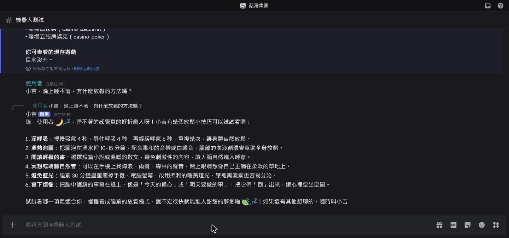
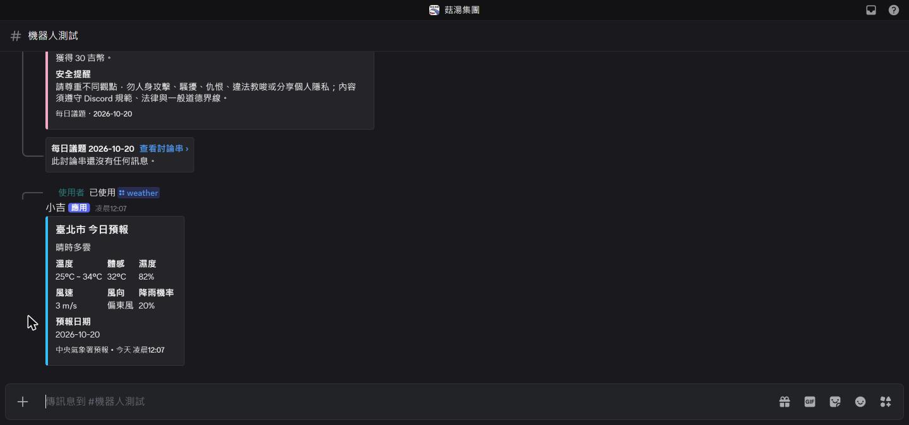
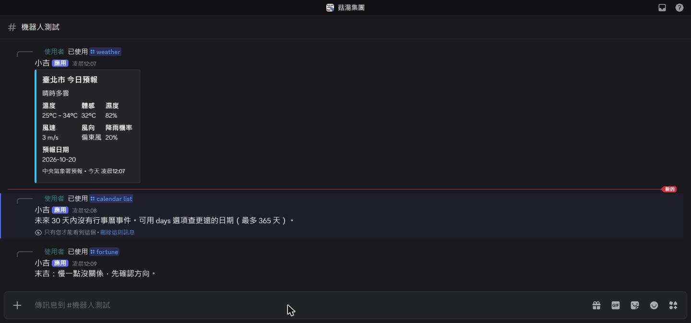
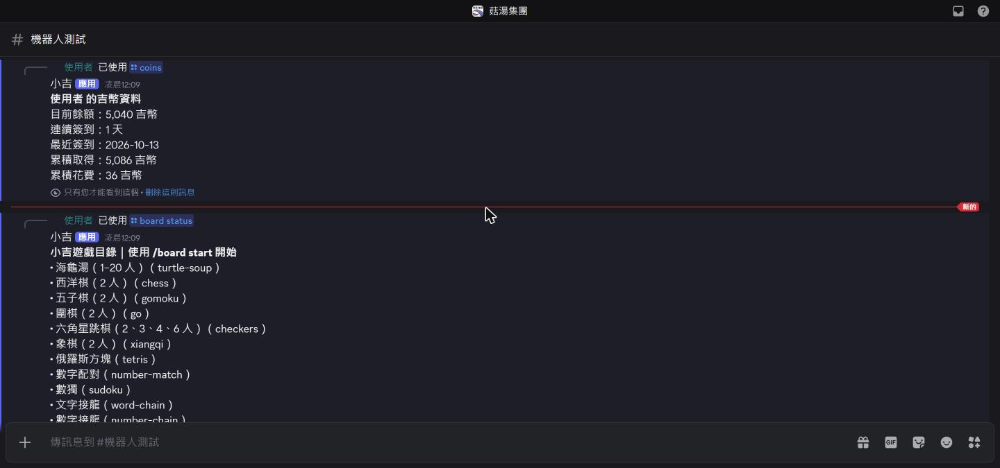
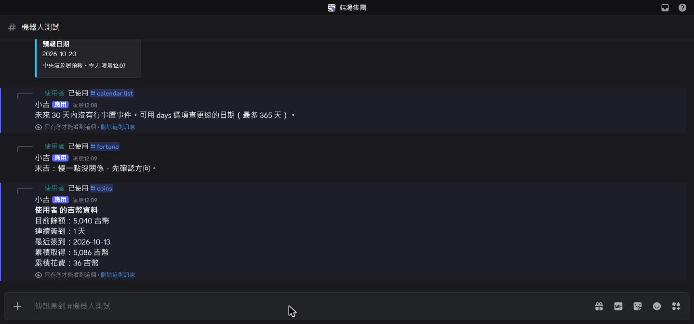
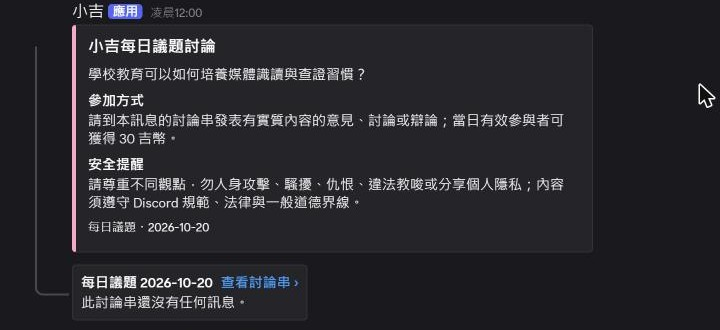
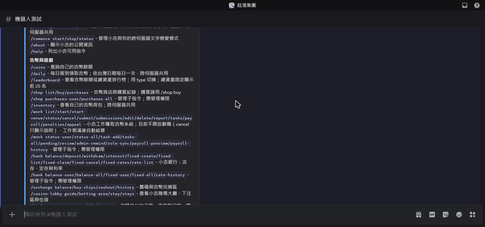

# 小吉：Discord 上的聊天好朋友

陪你聊天、玩遊戲、查天氣、記提醒，還有自己的吉幣小經濟。加入伺服器就能用，不用等審核。

官網：<https://xiaoji-zeta.vercel.app>　|　官方社群：<https://discord.gg/TqkCx9kYmk>　|　[版本更新](https://github.com/xichengyu810067-lab/xiaoji-formal/releases)

## 30 秒看懂 1.3.0 大更新

| 新功能 | 怎麼用 |
|---|---|
| 更聰明的聊天 | 小吉換上新的 AI，聊得更自然；遇到新聞、比賽結果這類即時問題，會自己上網查。 |
| 會看圖 | 聊天時附圖片給小吉看，每則最多 3 張。小吉不保存圖片，也不會認出照片裡的人是誰。 |
| 好奇寶寶 /student | 小吉開一個討論串問你問題，每輪最多 3 題，會接著你的回答繼續問。 |
| 記得你的喜好 | 小吉會記住你說過喜歡什麼。第一次聊天時由你決定要不要公開，用 /memory 隨時查看或刪除。 |
| 投票先確認 | 請小吉開投票時，會先給你看預覽，你按「確認」才會開出。 |
| 安全還在嗎？ | 都還在：你的吉幣只有你自己看得到，小吉也不會亂管你的伺服器。 |

## 小吉能做什麼

### 聊天
叫一聲「小吉」或直接 @ 小吉，就能用自然的中文聊天，也可以附圖片給小吉看。

### 查天氣
問一句，或輸入 /weather，馬上知道台灣各地今天的天氣。

### 娛樂與遊戲
抽籤、擲骰子，也能開海龜湯、棋類、俄羅斯方塊、數獨、接龍等遊戲，輸入 /board status 看有哪些可以玩。

### 吉幣
每天簽到領吉幣，可以逛商店、工作賺錢。你的吉幣只有你自己看得到。

### 每日議題
管理員開啟後，小吉每天自動發起一個話題，大家在討論串裡聊，認真發言還有吉幣。

### 小提醒與行事曆
幫你記事情、排行程，只有你自己看得到。

### 找不到功能？
輸入 /help，小吉會把所有功能整理給你。

## 想知道更多？

- 小吉需要哪些權限、哪些功能不會出現在你的伺服器：[管理功能隔離說明](docs/MANAGEMENT_ISOLATION.md)
- 隱私政策與服務條款：見[官網](https://xiaoji-zeta.vercel.app)
- 這次更新的完整內容：[1.3.0 版本說明](docs/releases/1.3.0.md)
- 使用說明：[使用指南](docs/USER_GUIDE.md)

### 給想深入研究的人（技術文件）

- 自己架設、安裝、備份、升級與故障處理：[安裝與維運](docs/OPERATIONS.md)
- 程式怎麼分層、怎麼新增功能與測試：[架構說明](docs/ARCHITECTURE.md)
- 全部指令的完整清單：[指令清單](docs/COMMANDS.md)
- 程式擴充的規則：[擴充介面](docs/EXTENSION_CONTRACT.md)
- 選用的 AI 第二意見怎麼設定：[AI 第二意見設定](docs/JEV_SETUP.md)

以上截圖都來自實機測試伺服器，截圖前已遮蔽所有成員的名稱、頭像與識別碼。
