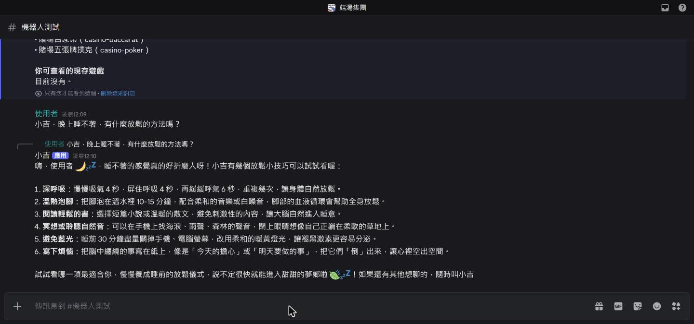
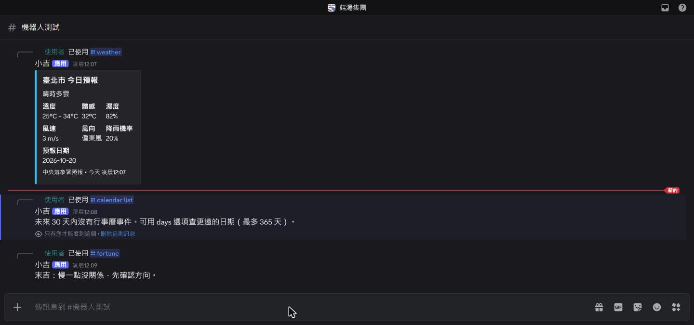
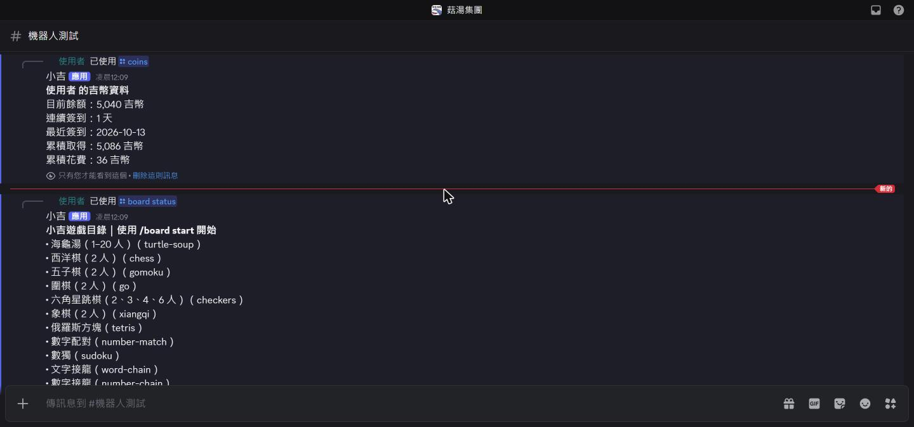
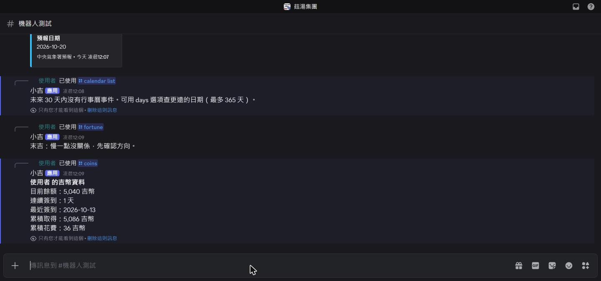
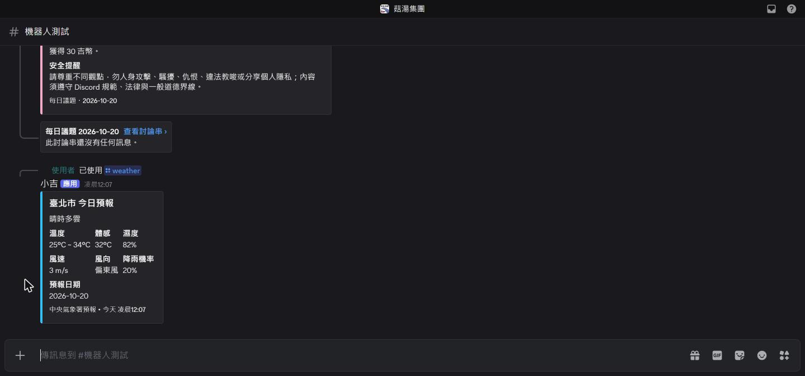
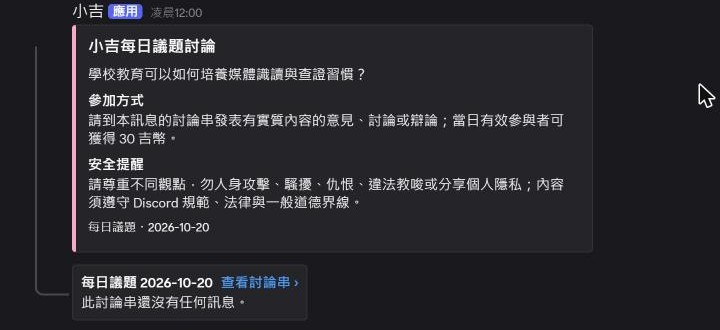
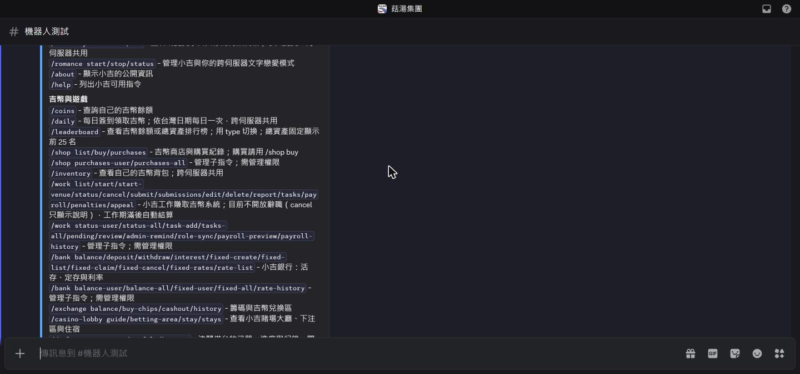
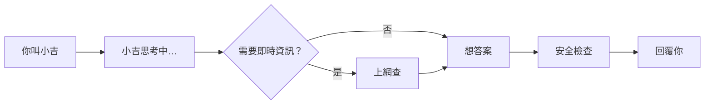

<picture>
  <source media="(prefers-color-scheme: dark)" srcset="docs/images/readme/banner-dark.svg">
  
</picture>

 

**[新功能](#new)** ・ **[能做什麼](#features)** ・ **[隱私與安全](#privacy)** ・ **[官網](https://xiaoji-zeta.vercel.app)** ・ **[社群](https://discord.gg/TqkCx9kYmk)** ・ **[更新紀錄](https://github.com/xichengyu810067-lab/xiaoji-formal/releases)**

> [!TIP]
> 陪你聊天、玩遊戲、查天氣、記提醒，還有自己的吉幣小經濟。加入伺服器就能用，不用等審核。

<h2></h2>

<table>
<tr>
<td width="50%"><h4><a href="#new">1　30 秒看懂 1.3.1 大更新</a></h4></td>
<td width="50%"><h4><a href="#weather">　2.6　查天氣</a></h4></td>
</tr>
<tr>
<td width="50%"><h4><a href="#features">2　小吉能做什麼</a></h4></td>
<td width="50%"><h4><a href="#daily-topic">　2.7　每日議題</a></h4></td>
</tr>
<tr>
<td width="50%"><h4><a href="#chat">　2.1　聊天</a></h4></td>
<td width="50%"><h4><a href="#reminders">　2.8　小提醒與行事曆</a></h4></td>
</tr>
<tr>
<td width="50%"><h4><a href="#memory">　2.2　記憶</a></h4></td>
<td width="50%"><h4><a href="#how">3　小吉怎麼回你的話</a></h4></td>
</tr>
<tr>
<td width="50%"><h4><a href="#stock-food">　2.3　股票與美食</a></h4></td>
<td width="50%"><h4><a href="#privacy">4　隱私與安全</a></h4></td>
</tr>
<tr>
<td width="50%"><h4><a href="#games">　2.4　遊戲</a></h4></td>
<td width="50%"><h4><a href="#more">5　想知道更多</a></h4></td>
</tr>
<tr>
<td width="50%"><h4><a href="#coins">　2.5　吉幣</a></h4></td>
<td width="50%"></td>
</tr>
</table>

<picture><source media="(prefers-color-scheme: dark)" srcset="docs/images/readme/divider-dark.svg"></picture>

<h2></h2>

<picture>
  <source media="(prefers-color-scheme: dark)" srcset="docs/images/readme/chat-dark.svg">
  
</picture>

<table>
<tr>
<td width="33%" valign="top">

### 💭 小吉思考中…
想答案時先回一聲「小吉思考中…」，想好再換成回答，不用乾等。

</td>
<td width="33%" valign="top">

### 🧠 記得聊過的話
記住大家在伺服器裡說過的話，問「小吉你知道我是誰嗎？」會照記憶回答。私訊一律不記。

</td>
<td width="33%" valign="top">

### 📈 股票與美食
/stock 看台股、美股、ETF 和加密貨幣的報價與走勢圖；/food 查食譜、找附近美食（美食地圖測試中，限授權伺服器）。

</td>
</tr>
<tr>
<td valign="top">

### 🌾 新遊戲
/farm 種田、/kitchen 做料理、狼人殺（小吉當法官）、/spark-relay 星火接續。

</td>
<td valign="top">

### 🔤 文字接龍更聰明
字典查不到的詞，小吉會幫忙判斷能不能接。

</td>
<td valign="top">

### 🌐 官網更好用
搜尋功能和指令、看每個功能現在正不正常，客服會直接回答問題。

</td>
</tr>
</table>

<picture><source media="(prefers-color-scheme: dark)" srcset="docs/images/readme/divider-dark.svg"></picture>

<h2></h2>

> 點一下標題就能展開說明和截圖。

<h3></h3>

<h3><picture><source media="(prefers-color-scheme: dark)" srcset="docs/images/readme/icons/chat-dark.svg"></picture> 叫一聲「小吉」或 @ 小吉，用自然的中文聊天</h3>

 

- 可以附圖片給小吉看，每則最多 3 張；小吉不保存圖片，也不會認出照片裡的人是誰。
- 遇到新聞、比賽結果這類即時問題，小吉會自己上網查。
- 請小吉開投票時，會先給你看預覽，你按「確認」才會開出。
- 好奇寶寶 /student：小吉開一個討論串問你問題，會接著你的回答繼續問。

<h3></h3>

<h3><picture><source media="(prefers-color-scheme: dark)" srcset="docs/images/readme/icons/memory-dark.svg"></picture> 記得你的喜好，也記得頻道裡聊過的話</h3>

 

- 小吉會記住你親口說過的喜好，例如喜歡的食物或遊戲。
- 伺服器裡的發言每人每天最多記 30 則，台北時間每月 1 號中午清空上個月的紀錄；私訊一律不記。
- 第一次聊天時由你決定記憶要不要公開：公開時，小吉所在的伺服器都能用；不公開時只在同一個伺服器裡用。
- 用 /memory 隨時查看用量、刪除紀錄或改設定，回覆只有你自己看得到。

<h3></h3>

<h3><picture><source media="(prefers-color-scheme: dark)" srcset="docs/images/readme/icons/stock-dark.svg"></picture> 報價、走勢圖、自選清單，還有食譜和附近美食</h3>

 

| 指令 | 可以做什麼 |
|---|---|
| /stock | 台股（上市、上櫃）、台灣與美國 ETF、美股、加密貨幣的報價和走勢圖，可以建自選清單；聊天時也能直接問小吉。 |
| /food | 查食譜、依地區和想吃的東西推薦附近美食。 |

> [!NOTE]
> 報價僅供參考，不是投資建議。

> [!WARNING]
> **伺服器美食地圖**（/food add、list、remove）目前是測試中的功能，**只有授權的伺服器才可以使用**；其他伺服器使用時，小吉會說明這是測試功能。

<h3></h3>

<h3><picture><source media="(prefers-color-scheme: dark)" srcset="docs/images/readme/icons/game-dark.svg"></picture> 抽籤、棋類、狼人殺、農場與廚房</h3>

 

- 抽籤、擲骰子，也能開海龜湯、棋類、俄羅斯方塊、數獨、文字接龍等遊戲，輸入 /board status 看有哪些可以玩。
- 狼人殺：用 /board start 開局，小吉當法官。
- /farm 種作物、/kitchen 做料理，可以出售、品嚐或送人。
- /spark-relay 星火接續：小吉隨機分組，每天輪一個人完成小任務，全組都有參與才發獎金。

<table>
<tr>
<td></td>
<td></td>
</tr>
</table>

<h3></h3>

<h3><picture><source media="(prefers-color-scheme: dark)" srcset="docs/images/readme/icons/coin-dark.svg"></picture> 每天簽到領吉幣，逛商店、工作賺錢</h3>

 

你的吉幣只有你自己看得到。

<h3></h3>

<h3><picture><source media="(prefers-color-scheme: dark)" srcset="docs/images/readme/icons/weather-dark.svg"></picture> 問一句，或輸入 /weather</h3>

 

馬上知道台灣各地今天的天氣。

<h3></h3>

<h3><picture><source media="(prefers-color-scheme: dark)" srcset="docs/images/readme/icons/topic-dark.svg"></picture> 每天一個話題，大家在討論串裡聊</h3>

 

管理員開啟後，小吉每天自動發起一個話題，認真發言還有吉幣。

<h3></h3>

<h3><picture><source media="(prefers-color-scheme: dark)" srcset="docs/images/readme/icons/clock-dark.svg"></picture> 幫你記事情、排行程</h3>

 

只有你自己看得到。找不到功能時，輸入 /help，小吉會把所有功能整理給你。

<picture><source media="(prefers-color-scheme: dark)" srcset="docs/images/readme/divider-dark.svg"></picture>

<h2></h2>

<picture><source media="(prefers-color-scheme: dark)" srcset="docs/images/readme/divider-dark.svg"></picture>

<h2></h2>

> [!IMPORTANT]
> 你的吉幣、提醒和行事曆只有你自己看得到，小吉也不會亂管你的伺服器。

- 小吉需要哪些權限、哪些功能不會出現在你的伺服器：[管理功能隔離說明](docs/MANAGEMENT_ISOLATION.md)
- 隱私權政策與服務條款：見[官網](https://xiaoji-zeta.vercel.app/policies.html)

<picture><source media="(prefers-color-scheme: dark)" srcset="docs/images/readme/divider-dark.svg"></picture>

<h2></h2>

- 這次更新的完整內容：[1.3.3 版本說明](docs/releases/1.3.3.md)、[1.3.2 版本說明](docs/releases/1.3.2.md)
- 使用說明：[使用指南](docs/USER_GUIDE.md)

<b>給想深入研究的人（技術文件）</b>

 

- 自己架設、安裝、備份、升級與故障處理：[安裝與維運](docs/OPERATIONS.md)
- 程式怎麼分層、怎麼新增功能與測試：[架構說明](docs/ARCHITECTURE.md)
- 全部指令的完整清單：[指令清單](docs/COMMANDS.md)
- 程式擴充的規則：[擴充介面](docs/EXTENSION_CONTRACT.md)
- 選用的 AI 第二意見怎麼設定：[AI 第二意見設定](docs/JEV_SETUP.md)

以上截圖都來自實機測試伺服器，截圖前已遮蔽所有成員的名稱、頭像與識別碼。

<picture>
  <source media="(prefers-color-scheme: dark)" srcset="docs/images/readme/footer-dark.svg">
  
</picture>
