# 小吉 1.3.4 公開指令實測截圖

1.3.4 候選版在實機測試伺服器測過的公開指令。

共 140 張。圖片都已去識別化：只留訊息區，成員名稱、頭像、@提及、伺服器名稱與 ID 皆已遮蔽。

## 一般與個人化

| 指令 | 畫面 |
|---|---|
| `/ping` | 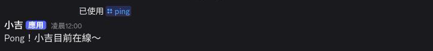 |
| `/fortune` |  |
| `/roll` | 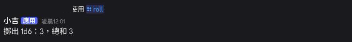 |
| `/weather` | 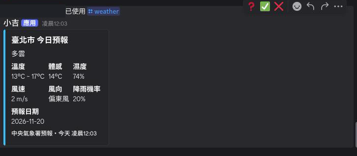 |
| `/stock quote` | 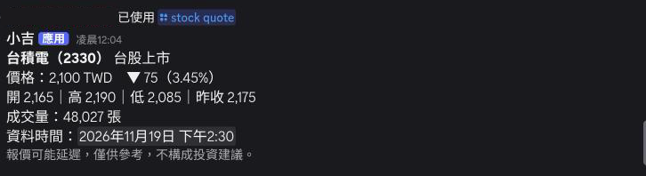 |
| `/stock chart` | 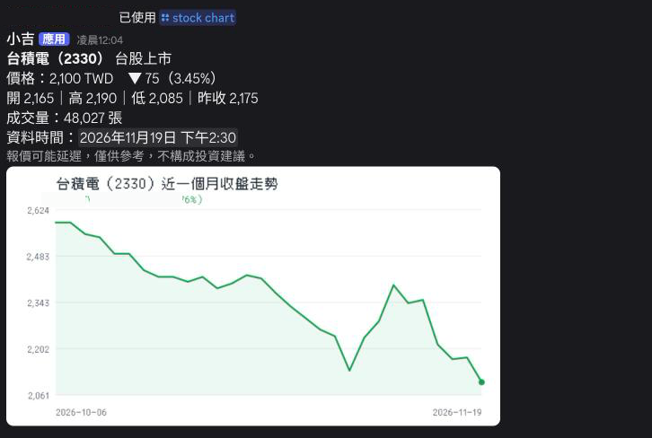 |
| `/stock watch-add、watchlist` | 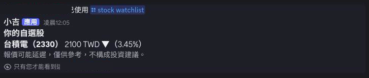 |
| `/stock watch-remove` | 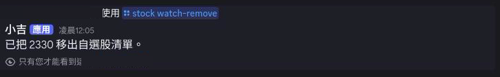 |
| `/poll` | 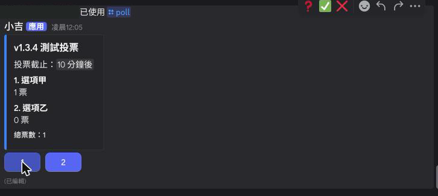 |
| `/remind add、list` | 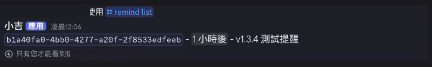 |
| `/calendar add、list` | 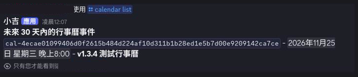 |
| `/calendar delete、/remind delete 與提醒觸發` | 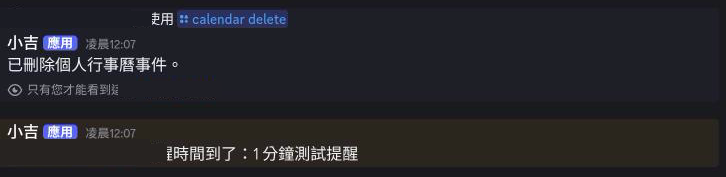 |
| `/chat-style current` |  |
| `/chat-style set` |  |
| `/help` | 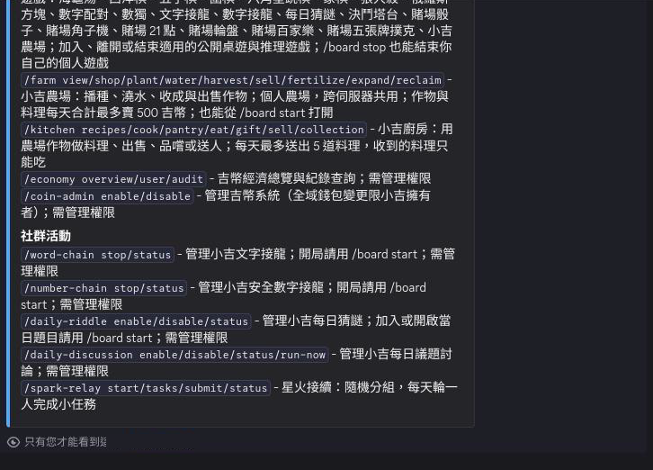 |
| `/memory nickname 查看與設定` |  |
| `/memory nickname 拒絕連結` |  |
| `/memory share 公開` | 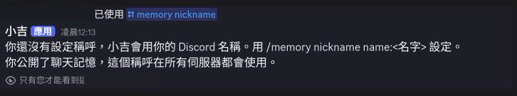 |
| `/memory nickname clear` |  |
| `/memory nickname name 與 clear 同時給` |  |
| `/student` |  |
| `/romance status` |  |
| `/romance start` |  |
| `/romance stop` |  |
| `/food recipe` | 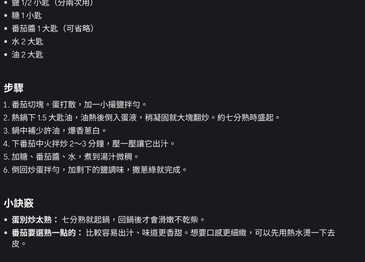 |
| `/food nearby` | 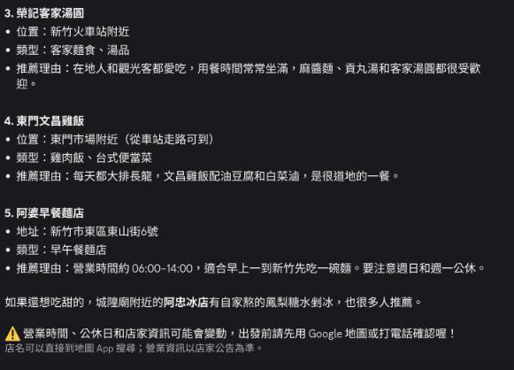 |
| `/about` |  |
| `/status` | 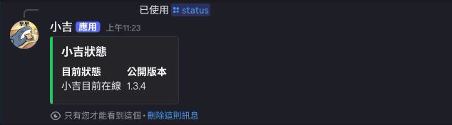 |

## 伺服器設定與社群活動

| 指令 | 畫面 |
|---|---|
| `/set-welcome` | 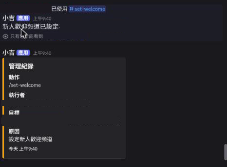 |
| `/release-announcements status` |  |
| `/release-announcements set` |  |
| `/coin-admin disable` |  |
| `/coins（吉幣停用時）` | 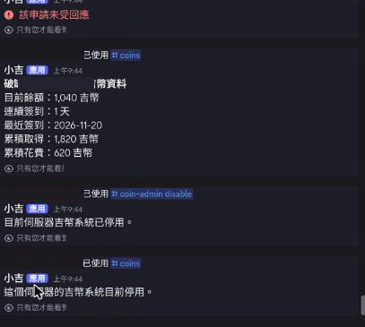 |
| `/coin-admin enable` |  |
| `/daily-discussion status` | 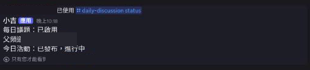 |
| `/daily-discussion run-now` |  |
| `/daily-riddle status` | 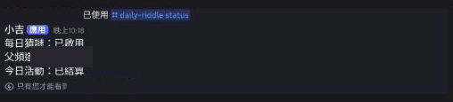 |
| `/daily-riddle disable` | 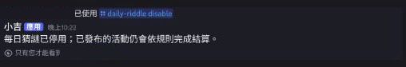 |
| `/daily-riddle enable` |  |
| `/word-chain status` |  |
| `/word-chain stop` |  |
| `/number-chain status` |  |
| `/spark-relay start` | 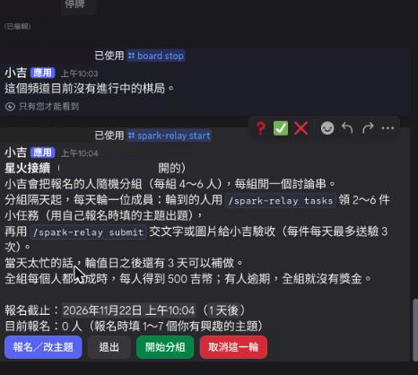 |
| `/spark-relay status` | 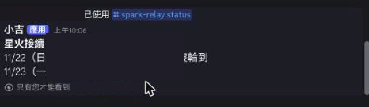 |
| `/spark-relay tasks` |  |
| `/spark-relay tasks`（輪值日領到任務） | 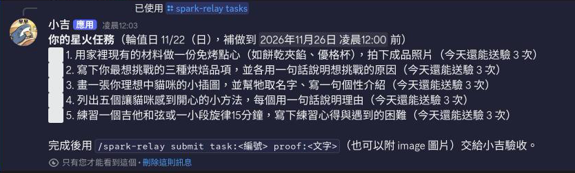 |
| `/spark-relay submit`（沒有附證明） | 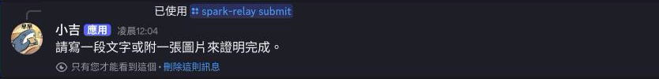 |
| `/spark-relay submit`（驗收通過） | 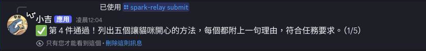 |
| `/spark-relay submit`（驗收未通過） | 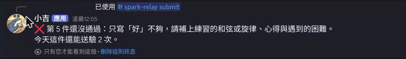 |
| `/spark-relay tasks`（交件後的完成標記） | 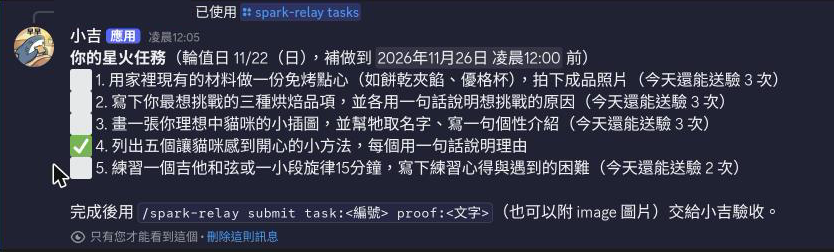 |

## 吉幣與經濟

| 指令 | 畫面 |
|---|---|
| `/coins` | 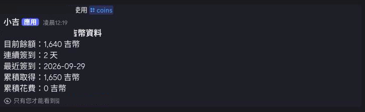 |
| `/daily` | 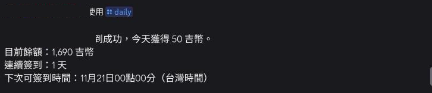 |
| `/inventory` |  |
| `/leaderboard` | 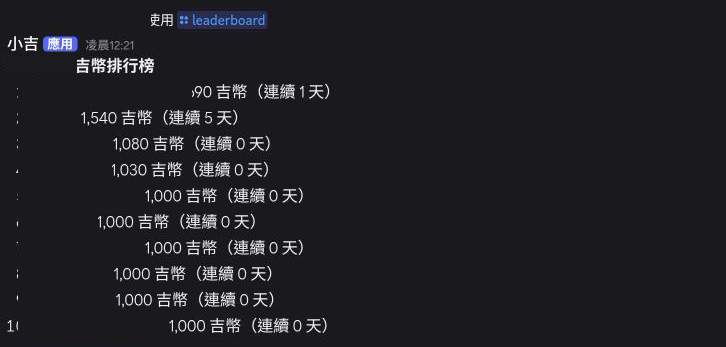 |
| `/shop list` |  |
| `/shop purchases` |  |
| `/bank balance` | 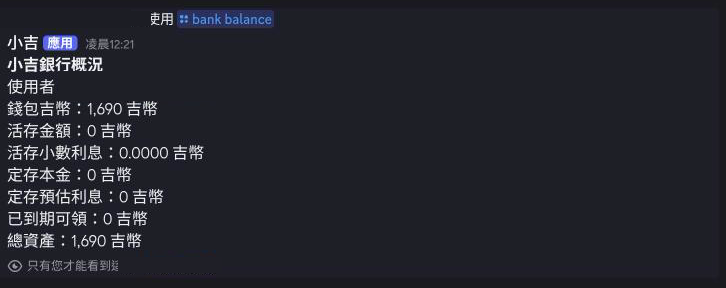 |
| `/bank fixed-rates` | 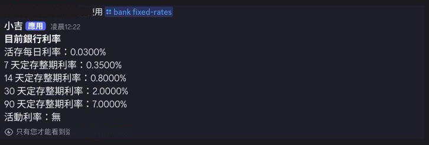 |
| `/bank deposit` | 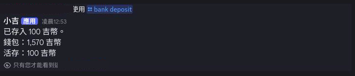 |
| `/bank interest` |  |
| `/bank withdraw` | 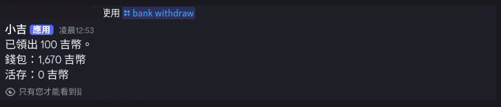 |
| `/bank fixed-create` | 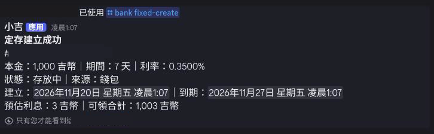 |
| `/bank fixed-list` | 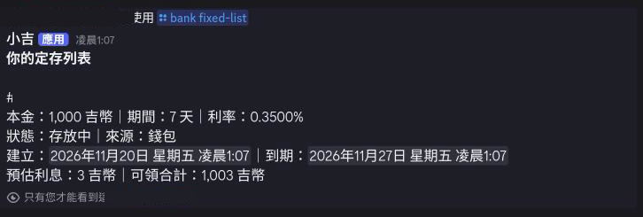 |
| `/bank fixed-cancel` | 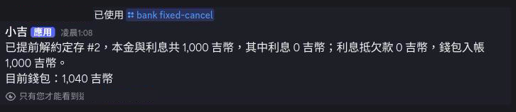 |
| `/exchange balance` | 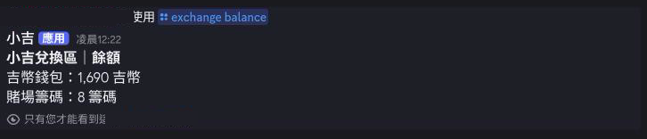 |
| `/exchange history` | 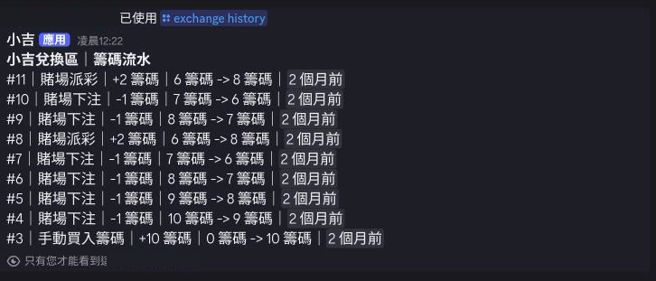 |
| `/exchange buy-chips` | 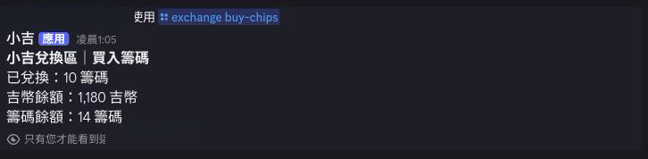 |
| `/exchange cashout` | 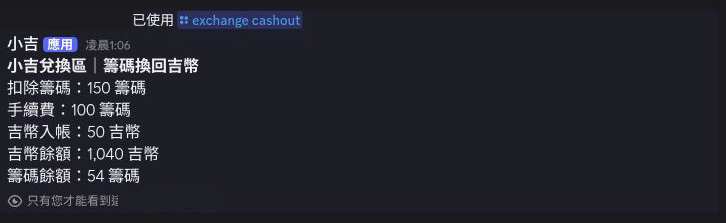 |
| `/casino-lobby guide` | 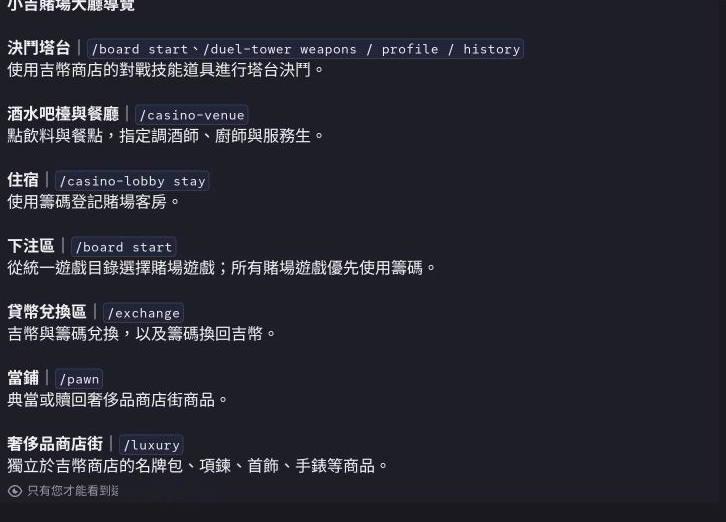 |
| `/casino loan-status` | 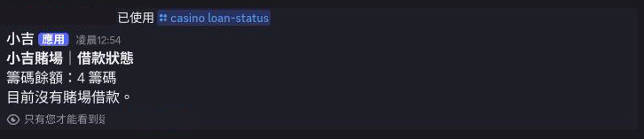 |
| `/casino history` | 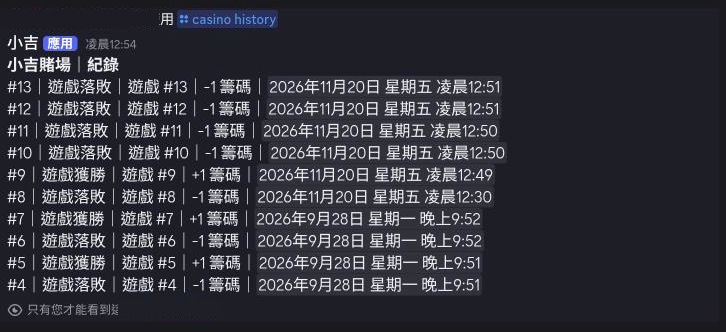 |
| `/duel-tower profile` | 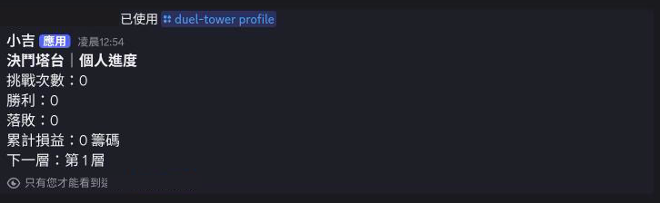 |
| `/casino-venue menu` | 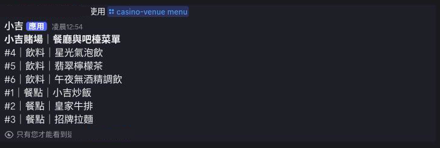 |
| `/luxury list` |  |
| `/pawn active` |  |

## 農場與廚房

| 指令 | 畫面 |
|---|---|
| `/farm view` | 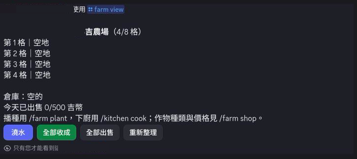 |
| `/farm shop` | 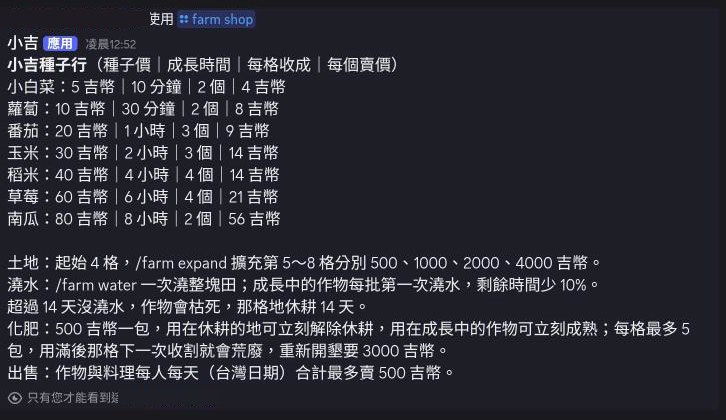 |
| `/farm plant` | 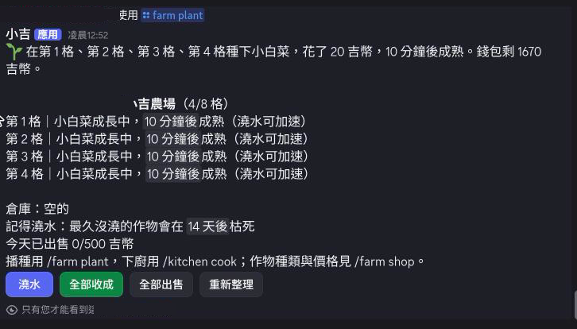 |
| `/farm water` |  |
| `/farm harvest` |  |
| `/farm harvest（未成熟）` |  |
| `/farm sell` |  |
| `/farm expand` |  |
| `/farm fertilize` |  |
| `/farm reclaim` |  |
| `/kitchen recipes` |  |
| `/kitchen pantry` |  |
| `/kitchen collection` |  |
| `/kitchen cook` |  |
| `/kitchen eat` |  |
| `/kitchen sell` |  |
| `/kitchen gift` |  |

## 工作

| 指令 | 畫面 |
|---|---|
| `/work list` |  |
| `/work status` |  |
| `/work tasks-all` |  |
| `/work payroll` |  |
| `/work penalties` |  |
| `/work submissions` |  |
| `/work payroll-preview` |  |
| `/work payroll-history` |  |
| `/work pending` |  |
| `/work start` |  |
| `/work status（有待生效選擇）` |  |
| `/work cancel` |  |

## 遊戲（board）

| 指令 | 畫面 |
|---|---|
| `/board start 俄羅斯方塊` |  |
| `/board stop` |  |
| `/board start 數字配對` |  |
| `/board start 數獨` |  |
| `/board start 賭場骰子（缺少選項）` |  |
| `/board start 賭場骰子` |  |
| `/board start 賭場角子機` |  |
| `/board start 賭場 21 點` |  |
| `/board start 賭場輪盤` |  |
| `/board start 賭場百家樂` |  |
| `/board start 賭場五張牌撲克` |  |
| `西洋棋：大廳` |  |
| `西洋棋：開局` |  |
| `西洋棋：走棋` |  |
| `西洋棋：非法走法被拒` |  |
| `西洋棋：和棋` |  |
| `五子棋：大廳` |  |
| `五子棋：落子` |  |
| `五子棋：認輸` |  |
| `圍棋：大廳` |  |
| `圍棋：落子` |  |
| `圍棋：停一手` |  |
| `象棋：大廳` |  |
| `象棋：走子` |  |
| `象棋：認輸` |  |
| `六角星跳棋：大廳` |  |
| `六角星跳棋：對局` |  |
| `海龜湯：開局` |  |
| `海龜湯：提問` |  |
| `海龜湯：猜答案` |  |
| `/board start 文字接龍` |  |
| `文字接龍：進行中` |  |
| `/board start 數字接龍` |  |
| `數字接龍：進行中` |  |
| `星火接續：報名` |  |
| `星火接續：分組` |  |

